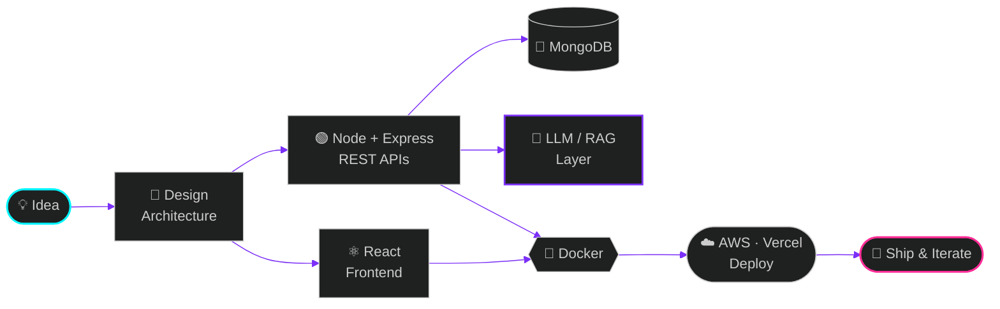

<!-- ╔══════════════════════════════════════════════════════════════╗ -->
<!-- ║   VIVEK MAURYA :: PROFILE.EXE  //  v2027.1  //  ONLINE      ║ -->
<!-- ╚══════════════════════════════════════════════════════════════╝ -->


<div align="center">

<a href="https://git.io/typing-svg">
  
</a>

<br/>


<br/><br/>


</div>

<br/>


<!-- ═══════════════════ WHOAMI ═══════════════════ -->

## `░▒▓ > whoami`

```ts
const vivek: Engineer = {
  name:       "Vivek Kumar Maurya",
  role:       "Full-Stack Developer (MERN) × AI/ML Student",
  education:  "B.Tech CSE (AI & ML) @ KIPM College of Engineering & Technology — 2027",
  location:   "Noida, India 🇮🇳",
  achievement:"🥉 3rd Place — Smart India Hackathon 2025",
  loading:    ["DSA in Java", "RAG & LLM-powered apps", "production-grade full-stack projects"],
  stack:      ["React", "Node.js", "Express", "MongoDB", "Docker", "AWS"],
  philosophy: "Crafting logic and elegance in every line of code",
  openTo:     ["Internships", "SDE roles", "Open-source collaboration"],
  status:     "compiling the future... 0 errors, many ambitions"
};
```

<!-- ═══════════════════ HUD ═══════════════════ -->

## `░▒▓ > system --status`

<div align="center">

| 🧠 CORE | ⚡ POWER | 🛰️ SIGNAL | 🔮 NEXT |
|:---:|:---:|:---:|:---:|
| **MERN + Java** | **React · Tailwind** | **Docker · AWS** | **RAG · LLM Agents** |
| `██████████ 90%` | `█████████░ 88%` | `███████░░░ 70%` | `████████░░ 78%` |

</div>

<!-- ═══════════════════ STACK ═══════════════════ -->

## `░▒▓ > stack --list --verbose`

<div align="center">

**〔 LANGUAGES 〕**


**〔 FRONTEND · BACKEND · DATA 〕**


**〔 DEVOPS · TOOLS 〕**


**〔 AI / GenAI 〕**


</div>

<!-- ═══════════════════ PIPELINE ═══════════════════ -->

## `░▒▓ > cat workflow.mermaid`



<!-- ═══════════════════ PROJECTS ═══════════════════ -->

## `░▒▓ > ls ./projects --featured`

<table>
<tr>
<td width="50%" valign="top">

### 📈 TradeX
**`Full-Stack Stock Trading Platform`**

A trading web app with secure auth, portfolio tracking and a live-feel interactive dashboard.

- 🔐 JWT + bcrypt authentication
- 📊 Holdings · positions · orders · watchlist · funds via REST APIs
- 🎨 Material UI + Chart.js dashboard
- 🛡️ Protected routes · Context API · CORS


[](https://github.com/vivek9369/TradeX)

</td>
<td width="50%" valign="top">

### 🏡 WanderLust
**`Airbnb-inspired Listing Platform`**

A property listing app with reviews, image uploads and session-based auth.

- ✍️ CRUD for listings & reviews
- 🔑 Passport.js authentication & authorization
- ☁️ Cloudinary + Multer image uploads
- ✅ Validation · error handling · Mongo session store


[](https://github.com/vivek9369/WanderLust)

</td>
</tr>
</table>

<!-- ═══════════════════ EXPERIENCE ═══════════════════ -->

## `░▒▓ > git log --experience`

```diff
+ [COMMIT] Web Development Intern  @  Dreamzz Technologies Pvt. Ltd.
+ [DATE]   Feb 2026 → May 2026  |  Remote
  │
  ├── ⚛️  Built responsive UIs with React.js, HTML, CSS & Tailwind CSS
  ├── 🧱 Created reusable React components for clean, maintainable code
  ├── 🔀 Collaborated through GitHub version-control workflows
  └── 📱 Ensured cross-device compatibility across multiple projects
```

<!-- ═══════════════════ ACHIEVEMENTS ═══════════════════ -->

## `░▒▓ > cat achievements.log`

<div align="center">


<br/>


</div>

<!-- ═══════════════════ STATS ═══════════════════ -->

## `░▒▓ > stats --live`

<div align="center">


<br/>


<br/>


</div>

<!-- ═══════════════════ SNAKE ═══════════════════ -->

## `░▒▓ > run snake.exe`

<div align="center">

<picture>
  <source media="(prefers-color-scheme: dark)" srcset="https://raw.githubusercontent.com/vivek9369/vivek9369/output/github-snake-dark.svg" />
  <source media="(prefers-color-scheme: light)" srcset="https://raw.githubusercontent.com/vivek9369/vivek9369/output/github-snake.svg" />
  
</picture>

</div>

<!-- ═══════════════════ CERTS ═══════════════════ -->

## `░▒▓ > cat certifications.log`

<div align="center">

| 🏅 CERTIFICATION | 🏢 ISSUER | 📅 DATE |
|:--|:--|:--|
| Cloud Computing Fundamentals | **IBM** | Oct 2026 |
| Full Stack Web Development with AI | **Internshala** | Jun 2026 |
| Full Stack Development | **Apna College** | Oct 2025 |
| Coding: Dev & Adv Engineering (Job Simulation) | **Accenture NA — Forage** | Dec 2024 – Jan 2025 |
| Software Engineering Job Simulation | **Goldman Sachs — Forage** | Verified |

</div>

<!-- ═══════════════════ CONNECT ═══════════════════ -->

## `░▒▓ > connect --me`

<div align="center">

[](https://my-portfolio-nine-zeta-34y7130wc7.vercel.app/)
[](https://www.linkedin.com/in/vivek-maurya-/)
[](mailto:vivekmaurya705404@gmail.com)
[](https://www.instagram.com/vivek_maurya69)

<br/>


<br/><br/>

```text
┌──────────────────────────────────────────────────────────┐
│  > echo "If you like what you see, drop a ⭐ on my repos" │
│  > exit 0                                                │
└──────────────────────────────────────────────────────────┘
```

</div>

<!-- ═══════════════════ FOOTER ═══════════════════ -->


